# Push notifications and offline open for Open WebUI

[](https://github.com/Eliav2/open-webui-pwa-push/actions/workflows/ci.yml)
[](./LICENSE)

Three things [Open WebUI](https://github.com/open-webui/open-webui) does not do on its own, for phones and computers:

- **Push notifications.** A notification when a reply finishes, also when Open WebUI is closed. Reply, mute or mark as read from the notification itself; on Android, swiping it away marks the chat read.
- **Offline open** (`OFFLINE`). Open WebUI opens with a slow network or none, showing the chats you read last, read-only.
- **Instant chat open** (`CHAT_CACHE`). A chat you opened before shows at once from the copy kept on the device, and the newest messages replace it as soon as they arrive.

It works with **any Open WebUI**, whatever models you use. Nothing in Open WebUI is patched or rebuilt: a proxy in front of it (a Cloudflare Worker or nginx) serves two small scripts, and push adds one Open WebUI function. Offline open and instant chat open need only the proxy. If you use [OpenClaw](https://github.com/openclaw/openclaw) models through the [OpenClaw Pipe](https://github.com/Eliav2/openclaw-openwebui-integration), see [OpenClaw models](#openclaw-models).

<p align="center">
  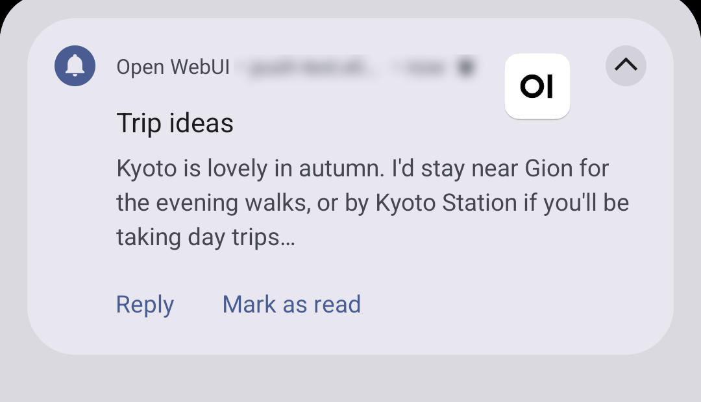
  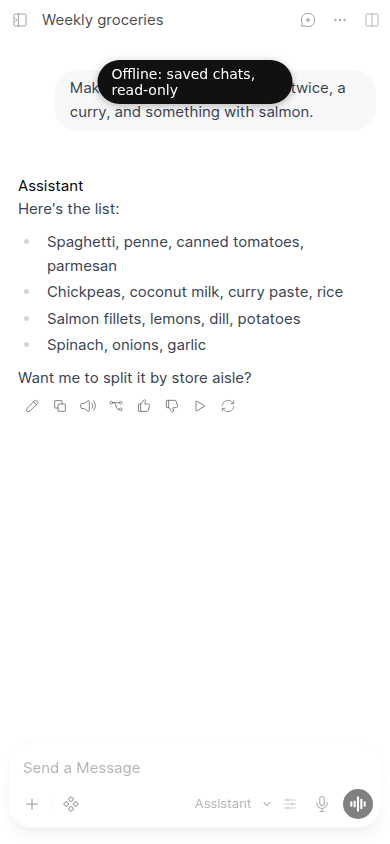
</p>

## Contents

- [How it works](#how-it-works)
- [Requirements](#requirements)
- [Install](#install): [the minimal install](#minimal-install-offline-and-instant-open) or [with push notifications](#full-install-with-push-notifications)
- [Features](#features), one section each, with a picture
- [Settings](#settings)
- [How it behaves](#how-it-behaves), [known limits](#known-limits), [turning it off](#turning-it-off)
- [Development](#development)

## How it works

| Part | File | Served as | What it does | Needed for |
|---|---|---|---|---|
| Service worker | [`web/oc-sw.js`](./web/oc-sw.js) | `/oc-sw.js` | Shows the notifications and runs their buttons; keeps the app and the chats read last on the device | everything |
| Page script | [`web/oc-push.js`](./web/oc-push.js) | `/static/loader.js` | Registers the service worker; offers "Enable notifications" and saves each device's subscription; adds the bell and the menu items; the offline and "Updating…" pills | everything |
| Event function | [`openclaw_web_push.py`](./openclaw_web_push.py) | an Open WebUI function | On each `chat.finished`, sends a push to each of the user's devices | push only |

Open WebUI loads `/static/loader.js` on every page (the file is empty in a stock install), but it rebuilds `/static` on every start, so both scripts come from the proxy, not from Open WebUI's files. The [Cloudflare Worker](#serve-the-scripts-with-a-cloudflare-worker) and [nginx](#serve-the-scripts-with-nginx) examples answer exactly those two paths and pass everything else through.

**Push is optional.** Without the VAPID key and the function id the proxy serves the same scripts with push off (SW-only mode): offline open and instant chat open work, and nothing about notifications shows. Checked on a live install with the function on, turned off, and deleted: the service worker registered, a chat opened before came from the kept copy, and with every request to the server blocked the chat still opened, read-only.

## Requirements

- **Open WebUI 0.13.0.** The menu items, the bell and the notification's Reply use Open WebUI 0.13.0's pages and API. A different version may draw its menus differently: then our items are left out and the browser console says so once; the rest keeps working.
- **HTTPS.** Browsers allow service workers only on HTTPS (or `localhost`).
- **A proxy at the root of the Open WebUI hostname** where you can serve two paths, `/oc-sw.js` and `/static/loader.js`: the [Cloudflare Worker](#serve-the-scripts-with-a-cloudflare-worker) in this repo, or [nginx](#serve-the-scripts-with-nginx). Open WebUI served under a sub-path (`example.com/openwebui/`) is not supported.
- **Browsers:** Chrome, Edge and Firefox on desktop and Android. On **iPhone and iPad, iOS/iPadOS 16.4 or later, with Open WebUI added to the Home Screen** and opened from there. In a Safari tab the page script does nothing at all: no service worker, so no notifications, no offline open and no instant chat open.
- **For push notifications only:**
  - a VAPID key pair (made once, [step 1](#1-make-a-vapid-key-pair));
  - the event function installed in Open WebUI ([step 2](#2-install-the-function));
  - outbound HTTPS from the Open WebUI container to the push services (`fcm.googleapis.com`, `web.push.apple.com`, `updates.push.services.mozilla.com`).
- **OpenClaw models only:** the Pipe's `PUBLISH_CHAT_FINISHED` on ([OpenClaw models](#openclaw-models)).

## Install

### Minimal install: offline and instant open

No key, no function. Serve the two scripts with offline open on:

- **Cloudflare Worker:** deploy [`examples/cloudflare-worker`](./examples/cloudflare-worker) ([below](#serve-the-scripts-with-a-cloudflare-worker)) with `OFFLINE` and `CHAT_CACHE` set to `"1"` and without `VAPID_PUBLIC_KEY` and `FUNCTION_ID`.
- **nginx:** copy the two scripts without replacing the push placeholders, and switch offline open on:

  ```bash
  mkdir -p /srv/open-webui-push
  sed -e "s/__OC_OFFLINE__/1/g" -e "s/__OC_CHAT_CACHE__/1/g" web/oc-sw.js > /srv/open-webui-push/oc-sw.js
  cp web/oc-push.js /srv/open-webui-push/oc-push.js
  ```

  then add the two locations from [`examples/nginx.conf`](./examples/nginx.conf).

Open Open WebUI once online on each device: from the next open on, it works offline and opens chats from the device.

### Full install: with push notifications

#### 1. Make a VAPID key pair

The push services check each push against this key pair. Make it once, where Open WebUI can read the private key, for example in its data volume:

```bash
mkdir -p <data volume>/web-push
openssl ecparam -name prime256v1 -genkey -noout -out <data volume>/web-push/vapid_private.pem
openssl ec -in <data volume>/web-push/vapid_private.pem -pubout -outform DER | tail -c 65 | base64 | tr '/+' '_-' | tr -d '=\n'
```

The private key file must be readable by the user Open WebUI runs as inside its container: the official image runs as root, so `openssl`'s owner-only file works there; with another user, `chown` the file to it. The last command prints the public key (87 characters). It is not a secret: the page script gets it. Keep a backup of the private key; a new one makes every device subscribe again. The private key stays in a file, not in a valve: Open WebUI stores valves unencrypted unless `ENABLE_VALVE_ENCRYPTION` is on.

#### 2. Install the function

In **Admin Panel > Functions**, add a function with the content of [`openclaw_web_push.py`](./openclaw_web_push.py), id `openclaw_web_push`, and turn it on. Open WebUI installs its one requirement, `pywebpush`, on the first load (unless `ENABLE_PIP_INSTALL_FRONTMATTER_REQUIREMENTS` is off; then install it into the container yourself). Then set its [valves](#settings): `VAPID_PRIVATE_KEY_FILE` if the key is not at the default path, and `VAPID_SUBJECT`, a `mailto:` address or `https:` URL where the push services can reach you. `VAPID_SUBJECT` is required unless Open WebUI's `WEBUI_URL` is an `https://` URL on a public host; on an `http://` setup, set it. The subject must name a public host: Apple's push service refuses `localhost`, `.local` and bare names (403 `BadJwtToken`) even where Google's and Mozilla's take them. A value that can't work is refused when you save the valves: Open WebUI shows only its generic `Error updating function valves`, and its log says why (`VAPID_SUBJECT must be a mailto: address or an https: URL ...`). With neither, nothing is sent: the page tells each user who turned notifications on why (until it is fixed), and Open WebUI's log says so once, as an error: `web push: nothing can be sent: VAPID_SUBJECT is empty and WEBUI_URL '...' ...`.

<p align="center">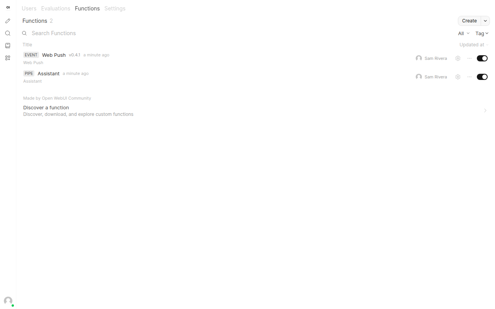 Functions in Open WebUI: the Web Push function (an EVENT function) listed and turned on" width="640"></p>

#### 3. Serve the two scripts

Give the proxy the public key from step 1 and the function's id (`openclaw_web_push`): the [Cloudflare Worker](#serve-the-scripts-with-a-cloudflare-worker)'s `VAPID_PUBLIC_KEY` and `FUNCTION_ID`, or the [nginx](#serve-the-scripts-with-nginx) copy with both placeholders replaced. `OFFLINE` and `CHAT_CACHE` are up to you.

#### 4. Turn it on, on each device

Open Open WebUI and click **Enable notifications** ([below](#enable-notifications)). On iPhone and iPad, add Open WebUI to the Home Screen first and open it from there.

### Serve the scripts with a Cloudflare Worker

[`examples/cloudflare-worker`](./examples/cloudflare-worker) is a Worker for exactly two routes of your Open WebUI hostname: `/oc-sw.js`, which it serves itself, and `/static/loader.js`, which it fetches from Open WebUI and appends the page script to. It never runs on `/api`, `/ws` or `/_app`.

Its settings (`vars`):

| Var | Value |
|---|---|
| `OFFLINE` | `"1"`: [offline open](#offline-open) on. Anything else: off. |
| `CHAT_CACHE` | `"1"` (with `OFFLINE` on): [instant chat open](#instant-chat-open) on. |
| `VAPID_PUBLIC_KEY` | The public key from step 1. Leave it out for the minimal install. |
| `FUNCTION_ID` | `openclaw_web_push`, the function's id. Leave it out for the minimal install. |

With wrangler:

```bash
cd examples/cloudflare-worker
cp wrangler.example.jsonc wrangler.jsonc   # your hostname and zone in "routes", and the vars above
npx wrangler deploy
```

The API token needs Workers Scripts: Edit (account) and Workers Routes: Edit (zone).

To try it first without a Cloudflare zone, run it locally in front of Open WebUI (here on port 3000) and open `http://localhost:8788`:

```bash
cd examples/cloudflare-worker
cp wrangler.example.jsonc wrangler.jsonc   # the vars above; the routes do not matter locally
npx wrangler dev --port 8788 --local-upstream localhost:3000
```

Locally every path reaches the Worker, which passes all but its two to Open WebUI. `localhost` is a secure context, so the service worker and push work there; another host needs https. [`e2e/stack.sh`](./e2e/stack.sh) does the same with a throwaway Open WebUI.

Or with Cloudflare's button, which copies this repo into your GitHub account and deploys the Worker from it (the repo's [`wrangler.jsonc`](./wrangler.jsonc): offline open and instant chat open on, push off):

[](https://deploy.workers.cloudflare.com/?url=https://github.com/Eliav2/open-webui-pwa-push)

Then, in the Worker's **Settings > Domains & Routes**, add the two routes `<your Open WebUI host>/oc-sw.js` and `<your Open WebUI host>/static/loader.js`, and for push add `VAPID_PUBLIC_KEY` and `FUNCTION_ID` under **Settings > Variables**.

**Behind Cloudflare Access**, add a second Access application with a **Bypass** policy for `/oc-sw.js` and the icons (`/static/favicon.png`, `/static/logo.png`, `/static/apple-touch-icon.png`, `/static/web-app-manifest-*.png`). The browser checks for a new service worker without your Access session, and iOS fetches the Home Screen icon without it. These are static files with no data in them. Do not bypass all of `/static`.

### Serve the scripts with nginx

[`examples/nginx.conf`](./examples/nginx.conf) is a complete `server` block: Open WebUI proxied (with the WebSocket upgrade and buffering off, which its streaming needs), and the two files served from a folder next to nginx. nginx picks the two exact `location =` matches over `location /` wherever they are in the block. Put the files there with the placeholders replaced, for example:

```bash
mkdir -p /srv/open-webui-push
sed -e "s/__OC_OFFLINE__/1/g" -e "s/__OC_CHAT_CACHE__/1/g" web/oc-sw.js > /srv/open-webui-push/oc-sw.js
sed -e "s/__VAPID_PUBLIC_KEY__/<public key>/g" -e "s/__FUNCTION_ID__/openclaw_web_push/g" \
  web/oc-push.js > /srv/open-webui-push/oc-push.js
```

Leave out the second `sed` (copy `oc-push.js` as it is) for the minimal install, and the `__OC_…__` replacements for offline open off. The page script replaces Open WebUI's `loader.js`, which is empty unless you put something in it; if you did, append it to `oc-push.js`.

### The first load after you switch

Open WebUI serves `/static/loader.js` with no `Cache-Control` header, so browsers cache it for a while: on Cloudflare for the zone's Browser Cache TTL (4 hours by default), otherwise for a heuristic time. A device that loaded Open WebUI before you started serving the page script keeps the old, empty file until that runs out: nothing of this runs on it before then. Both examples serve the new file with `Cache-Control: no-cache`, so this happens only once, at the switch, and every later change reaches a device on its next page load. To avoid the wait, serve the page script a day ahead with push off; on Cloudflare a Cache Rule for `/static/loader.js` with Browser TTL "Respect origin" does the same. On one device, clearing the browser's cached files (not its cookies or site data) skips it.

On a device that already has the service worker with offline open on (for example, you go from the minimal install to the full one), the service worker keeps `/static/loader.js` like the rest of the app: it answers from its kept copy at once and fetches the new one for next time. So a changed page script shows from the **second** page load on that device; the Enable notifications offer appears then.

### OpenClaw models

Open WebUI's own `chat.finished` fires when the chat request ends. For OpenClaw that misses the replies the agent starts (cron, `sessions_send`, sub-agent results) and fires too early for a reply that outlives its request. Turn on the Pipe's [`PUBLISH_CHAT_FINISHED`](https://eliav2.github.io/openclaw-openwebui-integration/configuration#publish_chat_finished): the Pipe then publishes its own `chat.finished` once each reply is saved, and the function notifies that one for OpenClaw models (those whose id starts with a prefix in [`PIPE_MODEL_PREFIXES`](#settings), `openclaw_gateway.` by default). Other models need nothing: Open WebUI's own event is right for them.

## Features

### Enable notifications

While the browser has not been asked yet, an **Enable notifications** pill shows at the top of the page. Click it and allow notifications in the browser's prompt. The × hides the pill for good on that device. Each device is saved in its user's own list (the function's `subscriptions` user valve), so two people on one Open WebUI each get their own notifications. With push off (the minimal install) the pill never shows.

<p align="center">
  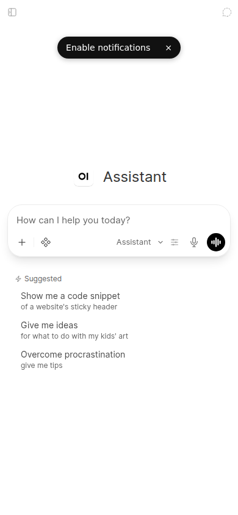
  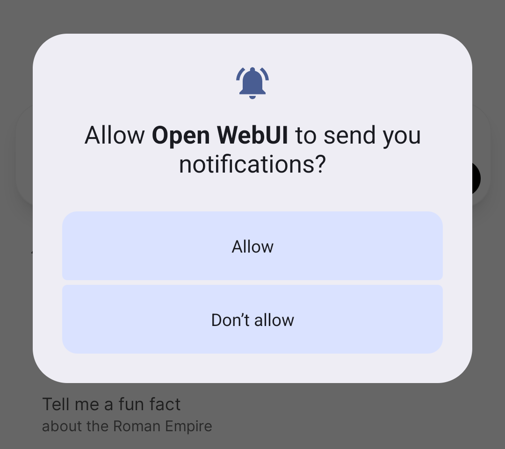
</p>

### Notifications

A notification when a reply finishes, on each of your devices, with the chat's title. It opens the chat when tapped.

- **One per chat, stacked.** A newer reply in the same chat joins the notification still showing, as in a messaging app: the title counts the replies (`Trip ideas · 3 new messages`) and, with previews on, the body keeps the latest 5 previews, newest last. Each new reply sounds once.
- **Not while you are looking.** While Open WebUI is open, visible and focused on a device, whatever chat is open, that device shows nothing (its sidebar shows the new reply). In the background, closed or with the screen off, it notifies. iOS always shows it (WebKit revokes a subscription whose pushes show nothing).
- **Title only, unless you turn on the preview.** The push carries the chat's title, its id and its link. With [`PREVIEW_CHARS`](#settings) above 0 the notification shows the start of the reply as plain text (code as "[code]", cut on a word). The preview is on the lock screen of every device you enabled; it passes through the browser's push service (Google, Apple or Mozilla) encrypted end to end. It is off by default.
- **Opened means read.** When a chat is opened on a device, by the notification or any other way, that device closes the chat's notification.
- **Your Open WebUI's icon.** The picture beside the text is your instance's own app icon, so a custom-branded Open WebUI shows its own. The service worker reads it once (the first picture in `/manifest.json`, else `/static/favicon.png`) and keeps it on the device; a new version of the service worker reads it again. Android's small status-bar icon is the browser's own: Android draws it from the picture's transparency only, and an app icon would be a blank square there. The admin valves [`NOTIFICATION_ICON` and `NOTIFICATION_BADGE`](#settings) set others.

<p align="center"></p>
<p align="center"><sub>With <code>PREVIEW_CHARS</code> on and <code>NOTIFICATION_ACTIONS=reply,read</code>. With the defaults the body says "New reply" and the buttons are Reply and Mute 8 h (Chrome adds its own Unsubscribe).</sub></p>

### Reply from the notification

**Reply** opens a text field in the notification (Android Chrome). What you type is sent to the chat as your message, the way Open WebUI 0.13.0's chat page sends one, and the model answers as if you had typed it in the app. While the chat's reply is still running, the message reaches it like one sent from another tab.

<p align="center">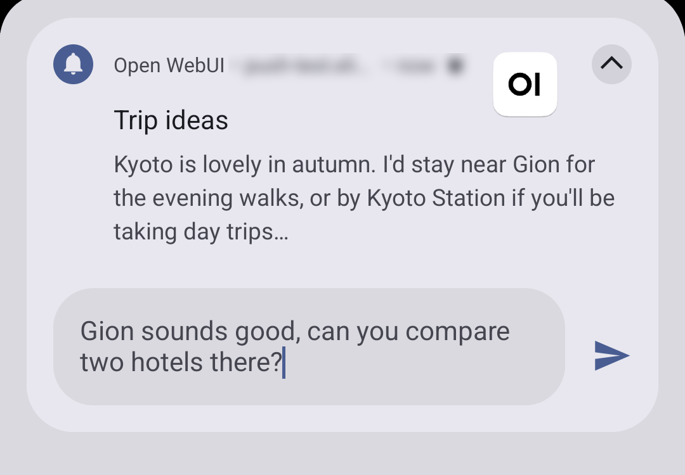</p>

### A reply that could not be sent

If the reply cannot be sent (signed out, the session expired, offline, the chat's model gone), nothing is lost: the chat opens with your text in the message box, once, and a line saying it was not sent.

<p align="center">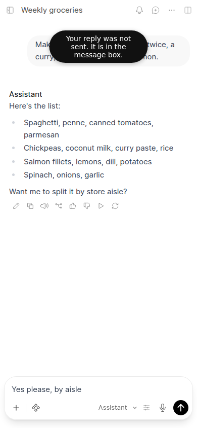</p>

### Mark as read, and swipe to read

- **Mark as read** in the notification: the chat's unread dot in Open WebUI's sidebar goes, on every device, without opening the chat. Pick it with [`NOTIFICATION_ACTIONS`](#settings) (`reply,read`). Open WebUI 0.13.0 keeps that dot on the server and sets it through its own Socket.IO event, the one its chat page sends when you open a chat; the service worker sends that event.
- **Swipe to read** (Android): a notification you swipe away marks its chat read the same way, and the shade stays open for the next one; **Clear all** marks every chat in it read. A notification the app closes itself (you opened the chat, a newer reply replaced it) never marks anything. It is your own [`swipe_read` setting](#your-own-settings), on by default.
- **Mark as read in the chat list:** a chat's ⋯ menu in the sidebar gets **Mark as read** after Open WebUI's own "Mark as unread". It needs only the service worker, so it is there in the minimal install too.

<p align="center">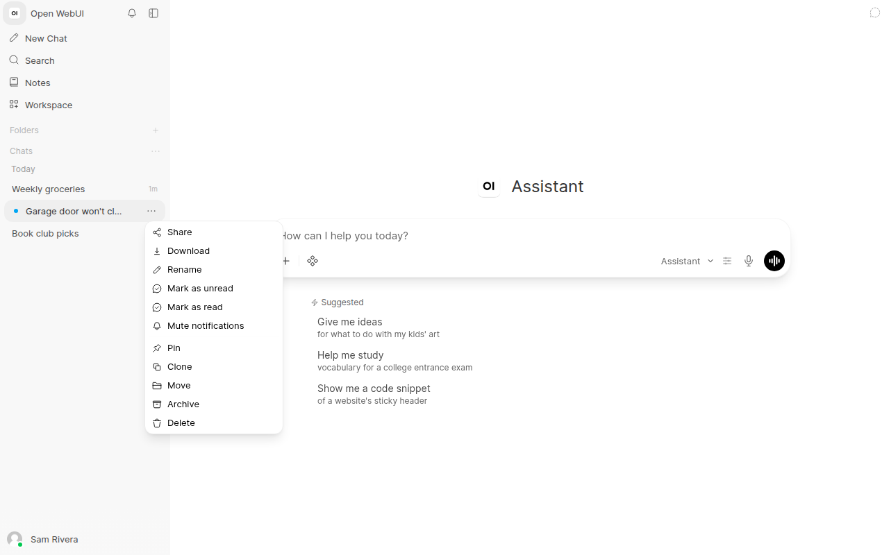</p>

### Mute a chat

In a chat, a bell in Open WebUI's header shows whether the chat notifies. Click it for **Mute for 1 hour**, **Mute for 8 hours**, **Mute always** or **Unmute**; a muted chat's bell is crossed out and its menu says until when. The same menu opens from **Mute notifications** in the chat's ⋯ menu in the sidebar, and **Mute 8 h** can be a notification button ([`NOTIFICATION_ACTIONS`](#settings)). A mute is kept on the server (the function's `mutes` user valve), so it applies to every device of yours; it is per user, so muting a shared chat mutes it only for you. The bell and the menu item show once a device of yours is enabled.

<p align="center">
  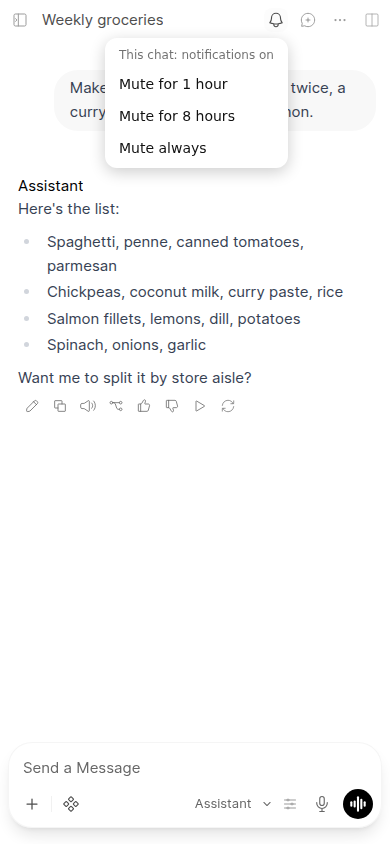
  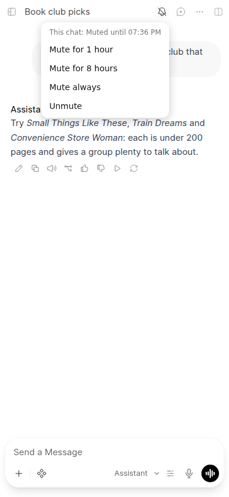
</p>

### Mute a folder

In a chat that is in a folder, the bell's menu has a second part for the folder: **Mute folder for 1 hour**, **for 8 hours**, **always**, or **Unmute folder**. A folder's own ⋯ menu has **Mute folder** after Open WebUI's "Mark all as read". A folder's mute covers the chats in it and in every folder inside it, so a folder of automated chats can stay quiet while your own chats notify. Folder mutes are kept like chat mutes (the `folder_mutes` user valve).

<p align="center">
  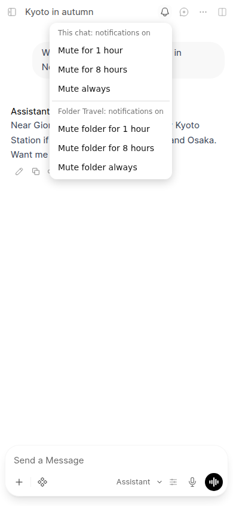
  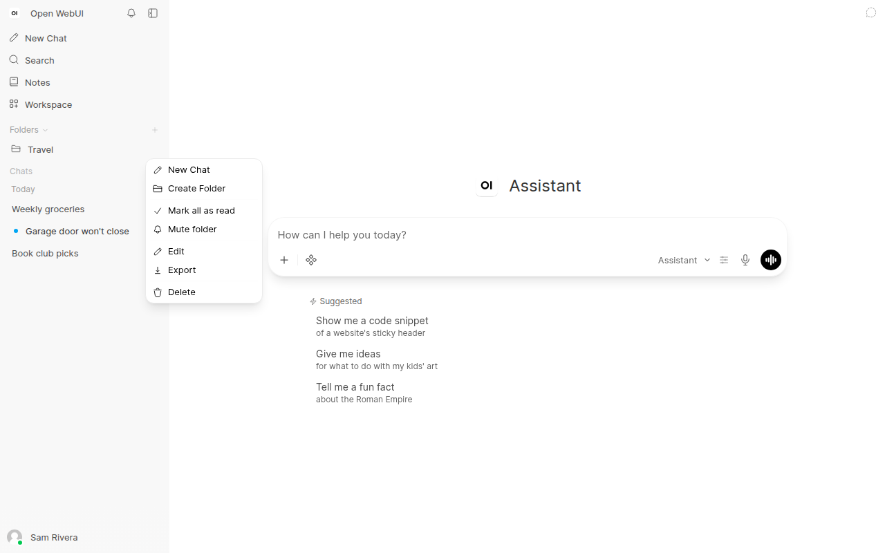
</p>

### Offline open

With `OFFLINE` on, the service worker keeps Open WebUI itself and the chats you read last on the device, so the app opens on a slow network, or with none. With no network a pill says "Offline: messages are sent when you're back online", and a message you send then [waits on the device](#sending-offline). The pill needs the device itself to be offline (the browser's `navigator.onLine`). With the device online and your server unreachable (the server, proxy or tunnel down), a kept chat opens the same way but with the "Updating…" pill of [instant chat open](#instant-chat-open), and its box stays locked until the server answers. A network that answers nothing at all is given up on after 4.2 s, then the kept copy is used. [Details](#offline-open-request-by-request).

<p align="center"></p>

### Sending offline

With `OFFLINE` on, the message box stays open with no network. A message you send then waits on the device, above the box ("Waiting for the network", with Edit and Delete), and survives closing the app. Several wait in order. Once the network is back and the chat is open, they go as one message, joined with a blank line (as Open WebUI joins its own queued messages), and the waiting ones disappear once the server has it. The same happens when the device says it is online but nothing gets through and Open WebUI's send fails on the network.

- Each waiting message keeps the chat and the point in the chat it was written at. It is never sent anywhere else: if the chat was deleted or its model is gone, it stays with the reason.
- Before sending, the chat is read from the server: a message that already got there (from another tab, or before a lost answer) is not sent again. Two tabs never send it twice.
- Messages waiting in a chat that is not open: a pill says how many wait and where, and opens that chat.
- Not kept offline: a new chat (it has no address yet), a chat not saved on this device, and a message with files. Each says so, and your text stays in the box.
- A browser that can't keep anything (private mode, no storage) sends as Open WebUI does, and the offline pill says the send will fail.

### Instant chat open

With `CHAT_CACHE` on (it needs `OFFLINE` on), a chat you opened before on that device opens from the copy kept of it, at once: Open WebUI otherwise downloads the whole chat on every open and shows none of it before the last byte. The network's copy is fetched behind it and replaces it by itself when it arrives (Open WebUI reads the chat again once it has joined the chat's live updates). Until then a pill says "Updating…" and the message box is locked: a message sent on an old copy could branch off an old point of the chat.

<p align="center">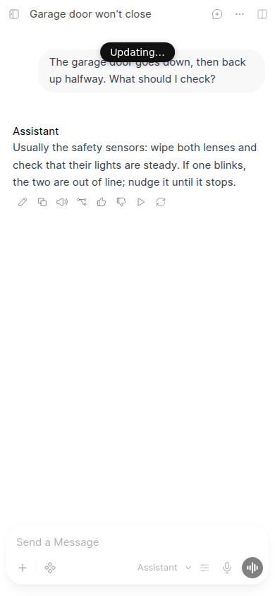</p>

### iPhone and iPad

Add Open WebUI to the Home Screen (Safari's Share > Add to Home Screen) and open it from there; iOS/iPadOS 16.4 or later. Then:

- every push shows a notification, also with Open WebUI in front (WebKit's rule);
- no buttons in the notification (no Reply, no Mute): a tap opens the chat; mute with the bell;
- the preview, muted chats and folders, offline open and instant chat open work as on Android.

In a Safari tab nothing of this runs (the page script stops at once there): no notifications, no offline open, no instant chat open.

### After a network change

A change of network while Open WebUI loads (Wi-Fi to mobile) can fail one of its files, and Open WebUI then shows "500 Internal Error" for good, or stays half drawn. The page script asks a failed start read once more on the new network, and reloads the app once when the server can be reached again. This works with offline open on or off, and with push off.

## Settings

The function's valves, in **Admin Panel > Functions > Web Push > Valves** (the gear):

| Valve | Default | What it does |
|---|---|---|
| `VAPID_PRIVATE_KEY_FILE` | `$DATA_DIR/web-push/vapid_private.pem` | The private key from step 1, as the container sees it. |
| `VAPID_SUBJECT` | Open WebUI's `WEBUI_URL` if it is `https://` on a public host, else none: nothing is sent | A `mailto:` or `https:` contact for the push services, on a public host (Apple refuses `localhost` and `.local`). Required on an `http://` setup. Refused on save if it can't work (the reason is in Open WebUI's log). |
| `TTL_SECONDS` | `3600` | How long a push service keeps a notification for a device that is offline. |
| `URGENCY` | `normal` | RFC 8030 urgency: `very-low`, `low`, `normal` or `high`. |
| `PIPE_MODEL_PREFIXES` | `openclaw_gateway.` | Models served by the OpenClaw Pipe. For these only the Pipe's own `chat.finished` is sent ([OpenClaw models](#openclaw-models)). |
| `NOTIFICATION_ACTIONS` | `reply,mute` | The notification's buttons, in order, from `reply`, `read`, `mute`. Android Chrome shows two. |
| `PREVIEW_CHARS` | `0` (off) | Up to this many characters of the reply in the notification ([privacy](#notifications)). |
| `NOTIFICATION_ICON` | empty | The picture beside the text: a path on the site (`/static/...`) or an `https:` URL. Empty: Open WebUI's own app icon. |
| `NOTIFICATION_BADGE` | empty | Android's small status-bar icon, drawn from its transparency only (a white shape on a transparent background). A path on the site or an `https:` URL. Empty: the browser's own. |

<p align="center">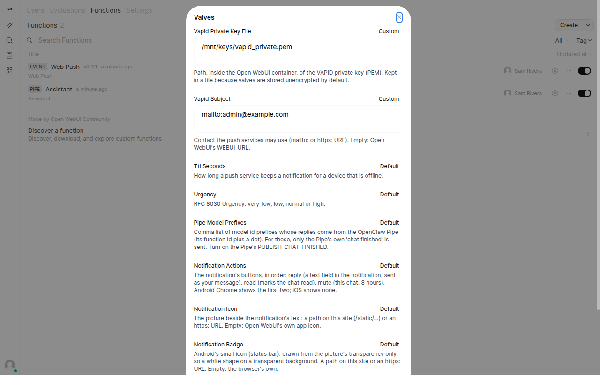</p>

### Your own settings

Each user's own valves of the function are in a chat's **Controls** (the sliders icon by the model) **> Valves > Functions > Web Push**. `subscriptions`, `mutes` and `folder_mutes` are written by the page script and the service worker, not by hand. `swipe_read` (on by default) is yours: off, a swiped notification only hides.

<p align="center">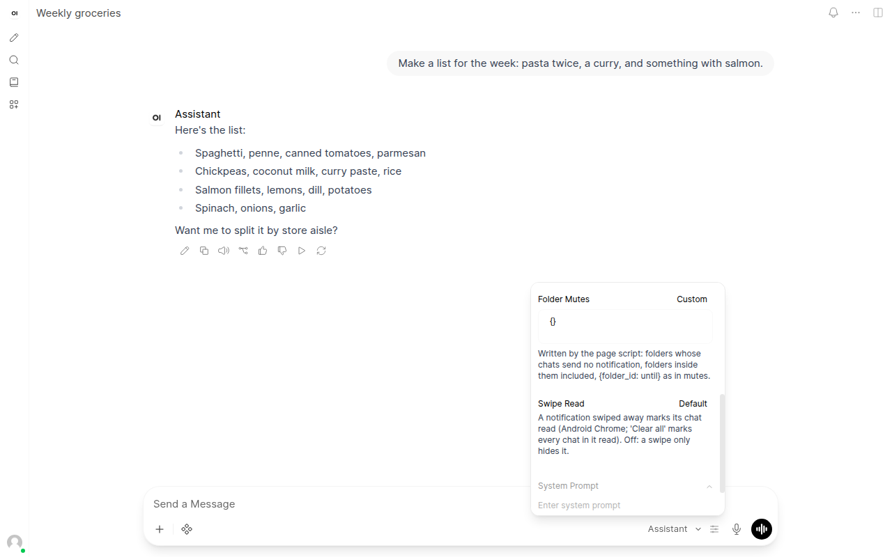</p>

## How it behaves

- **A new service worker** takes over by itself, on the next page load or when an app left open comes back to the front. Nothing to clear or reinstall.
- **After an Open WebUI update**, Open WebUI removes every service worker. The next time you open it on a device, it registers again with a new subscription, which replaces the old one. Replies that finish before that are not notified on that device.
- **Another user on the same device:** when someone else signs in, the page script drops the old subscription and makes a new one for them. Signing out alone does not.
- **Gone subscriptions:** a device whose push service answers 404 or 410 is removed from the user's list, and its next page load makes a new subscription in place of the dead one the browser may still hold. A subscription less than 10 minutes old is kept instead: Chrome's push service (FCM) refuses a brand-new one for a few seconds.
- **A brand-new device may get its first notification about 30 s late:** that's FCM taking the new subscription; the function sends a notification it refused once more when the subscription is 30 s old.
- **Tap to open:** a tap focuses an open Open WebUI window and opens the chat inside it, as a click in the sidebar does (no reload), or opens a new window when none is open.
- **The log:** what the function did is in Open WebUI's log, each line ending with the chat's id (`web push: sent to fcm.googleapis.com chat_id=…`, `web push: chat is muted, nothing sent chat_id=…`).

### Offline open, request by request

Only `GET` requests to your own Open WebUI; everything else goes straight to the network.

| Request | How |
|---|---|
| A page (any route: Open WebUI is one page) | The kept page at once, when it was kept with its Open WebUI version; `/api/version` is asked alongside it. Another version: everything kept is deleted and the page reloads once onto the server's own app. A redirect instead of a version (an expired Cloudflare Access session): the kept page is deleted and the reload shows the login. |
| Open WebUI's hashed files (`/_app/immutable/`) | Kept on first use, then read from the device: their names change with their content. |
| `/static/`, `/assets/`, your settings, models, config, banners, tags, functions, skills, tools | The kept copy at once, refreshed in the background for the next open. |
| The chat list, pinned chats, folders, each chat you open, `/api/version` | The network; the kept copy only when it fails (a chat opened before: the kept copy at once with `CHAT_CACHE` on). |
| Profile pictures | The kept copy at once, refreshed in the background. |

- **Only clean answers are kept:** a `200` from your own site, never a redirect, and a page only if it is Open WebUI's, so a login page or an error page never becomes the app.
- **Per user:** API answers, pictures and kept chats are kept per signed-in user (a cache named after a hash of the user's token). Signing in as someone else deletes the other user's; Open WebUI's sign-out deletes every user's.
- **Sizes:** at most 400 app files and 300 API answers per user. A chat bigger than 32 MB is not kept; all the kept chats of a user stay under 128 MB, the one opened longest ago going first.
- **Turning it off** (`OFFLINE` not `"1"`): the next service worker a device loads deletes everything it kept.

## Known limits

- **Two mute changes at the same time can lose one.** The bell, the menus and the notification's Mute button each read your user valves and write them all back, because Open WebUI's user-valve update replaces the whole set. Two writers at once (two devices, two tabs) can put back the other's old value. If a mute did not stick, change it again.
- **Open WebUI 0.13.0's pages.** The menu items are found by the structure and icons of Open WebUI 0.13.0's menus, not by their text (they are translated). A later version that draws them differently gets no items, and the console says once which menu it did not recognise. `e2e/` checks this contract against the pinned version.
- **Safari tabs** get nothing ([iPhone and iPad](#iphone-and-ipad)).
- **A push the push service accepted is its to deliver.** If the device's own connection to it is not up yet (seen once on a freshly reset Android Chrome), the notification comes late or not at all; the function is not told and sends nothing again.

## Turning it off

Each part is separate:

- Turn the function off: no notifications are sent. Offline open and instant chat open go on.
- `PREVIEW_CHARS` back to `0`: notifications say "New reply" again.
- `OFFLINE` or `CHAT_CACHE` off: see [offline open](#offline-open-request-by-request).
- Remove the Worker's routes or the nginx locations: pages load the stock `loader.js`. Service workers already registered stay idle until Open WebUI's next update removes them.

## Development

- `tests/` (pytest): the function's payload (never the reply), which events are sent, and a real encrypted send to a local push service. `uv run --with-requirements requirements-dev.txt pytest -q tests`
- `web/*.test.js`, `examples/cloudflare-worker/*.test.js` (`node --test`): the service worker, the page script and the Worker, in sandboxes.
- `e2e/`: Google Chrome against the real push service (FCM), the Worker example under `wrangler dev` and a throwaway Open WebUI 0.13.0. It needs Google Chrome (Chromium has no push service), Docker, `bunx` and outbound internet, and an `openclaw_pipe.py` build for the OpenClaw case ([the Pipe repo](https://github.com/Eliav2/openclaw-openwebui-integration)):

  ```bash
  e2e/stack.sh up /tmp/web-push-e2e openclaw_pipe.py
  E2E_RUN=/tmp/web-push-e2e WEB_PUSH_E2E=1 xvfb-run -a uv run --with playwright==1.64.0 --with pytest pytest -q e2e/test_web_push_e2e.py
  e2e/stack.sh down /tmp/web-push-e2e
  ```

- **Pictures:** `docs/screenshots.py` takes the Open WebUI pictures in `docs/img/` from the same e2e stack, with made-up chats ([`docs/fixtures/`](./docs/fixtures)):

  ```bash
  E2E_RUN=/tmp/web-push-e2e xvfb-run -a uv run --with playwright==1.64.0 --with pytest python docs/screenshots.py
  ```

  The Android pictures (`android-*.png`) are from an Android emulator, with a made-up chat on a test host.
- Rules for changes: [AGENTS.md](./AGENTS.md).

## License

MIT, see [LICENSE](./LICENSE).
